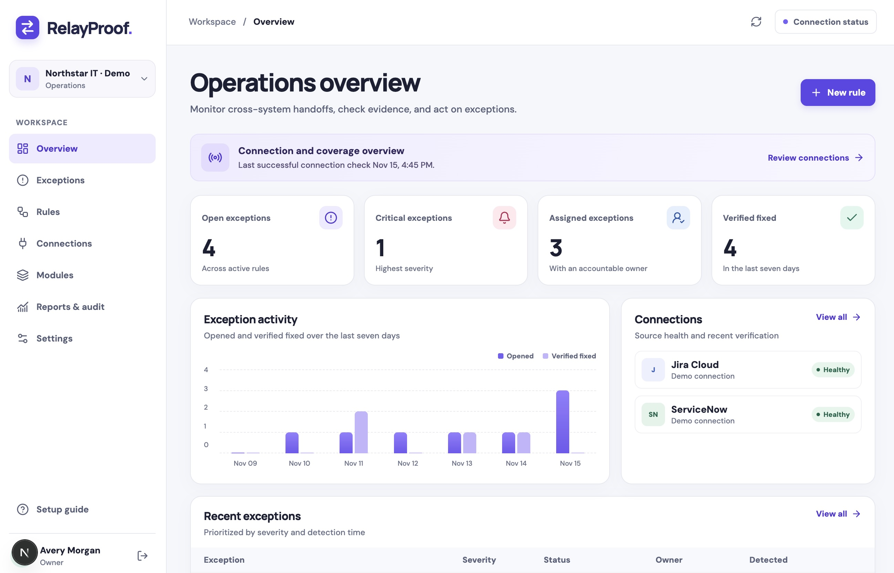
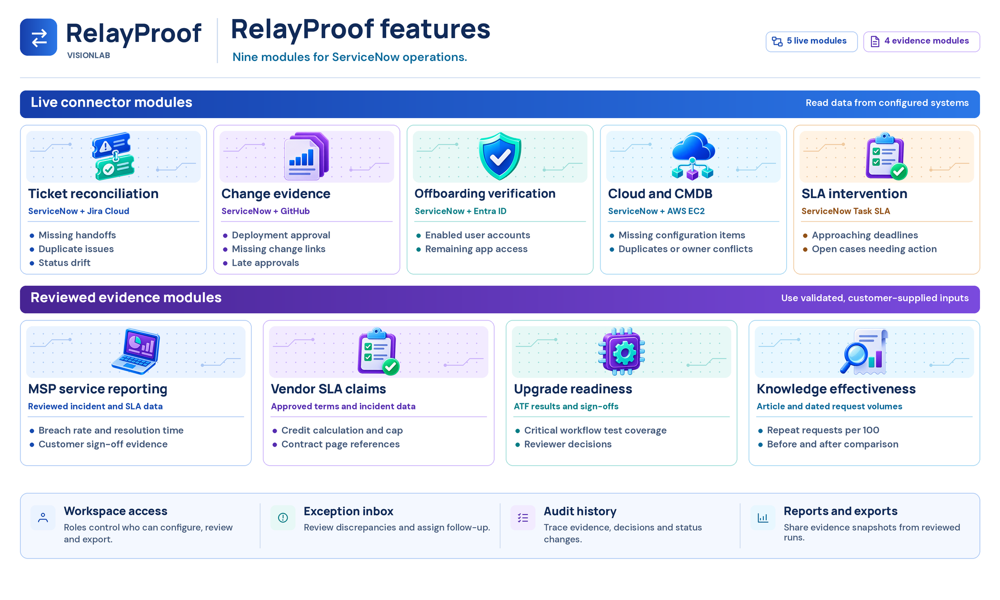
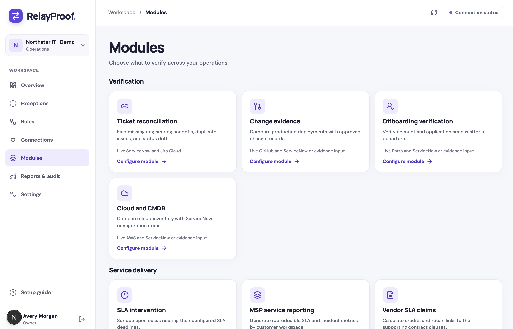
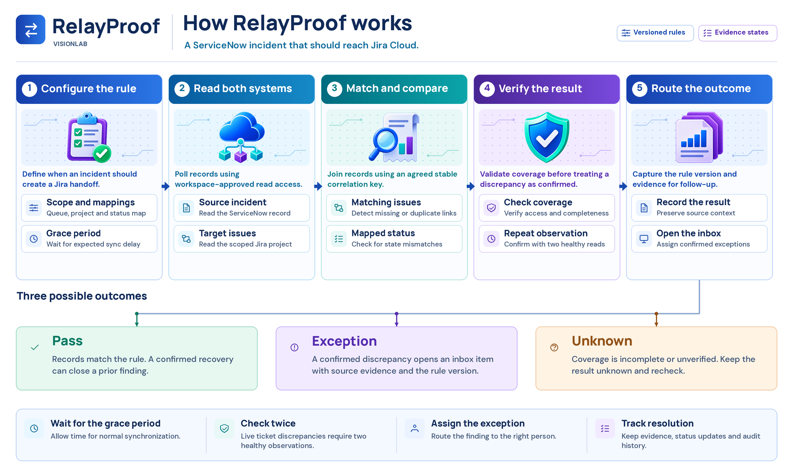
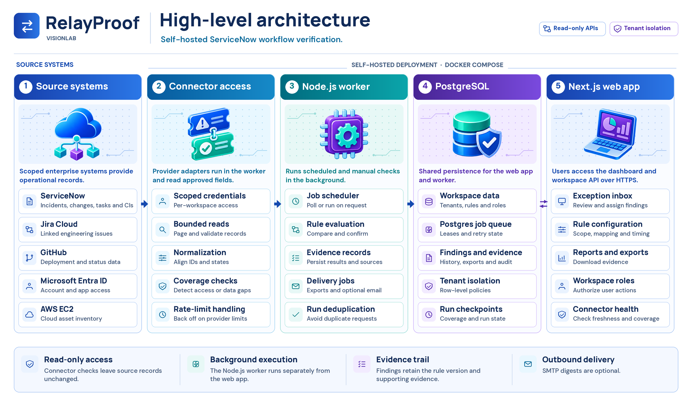
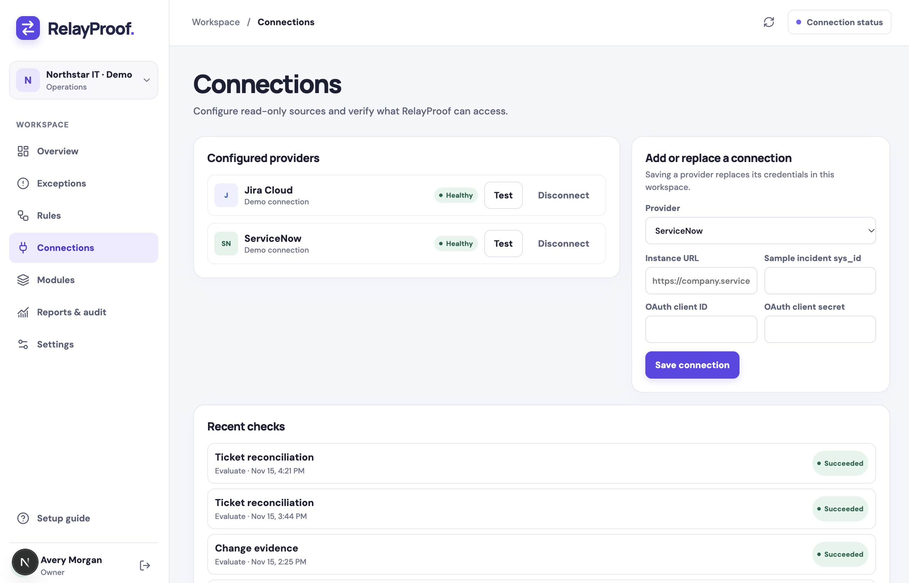
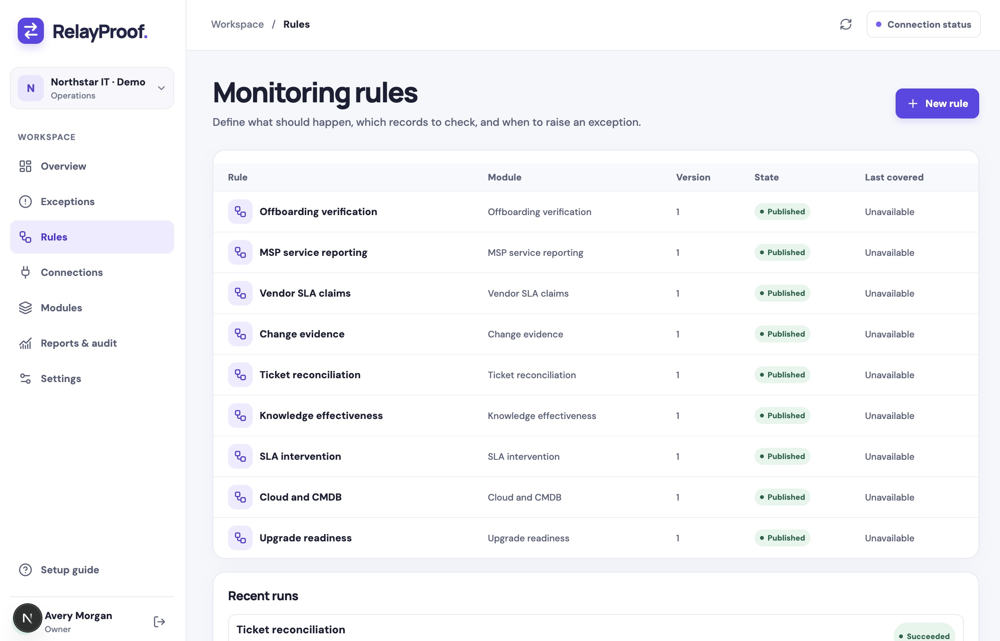
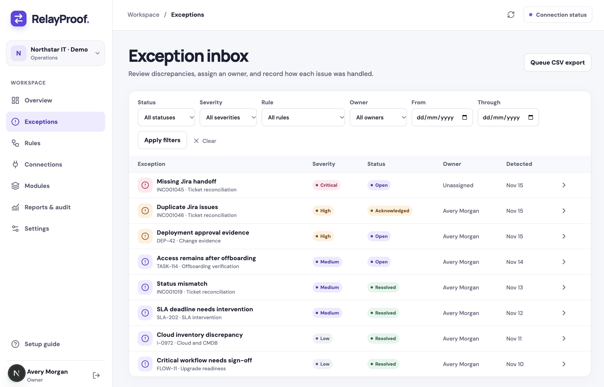
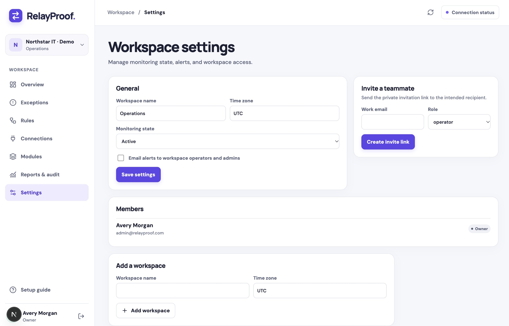

# RelayProof

RelayProof is a multi-tenant, self-hosted B2B SaaS platform for verifying ServiceNow handoffs and cross-system operational workflows. It checks that ServiceNow ITSM incidents reach the right Jira Cloud project, verifies deployment change approvals in GitHub, audits offboarding access in Microsoft Entra ID, reconciles AWS EC2 inventory against ServiceNow CMDB, and monitors Task SLA deadlines—all using read-only APIs and tamper-evident audit trails.



---

## Documentation

- [Deployment and operations](docs/deployment.md)
- [Connector setup and module inputs](docs/modules.md)
- [Architecture, coverage, and API](docs/architecture.md)
- [OpenAPI specification](docs/openapi.yaml)

---

## Features & Modules

RelayProof provides **5 live connector modules** (which can also run against reviewed JSON evidence) and **4 reviewed-evidence modules**. Findings never modify source records.



### Live Connector Modules
| Module | Sources | What it checks |
| --- | --- | --- |
| **Ticket reconciliation** | ServiceNow incidents + Jira Cloud issues | Missing handoffs, duplicate Jira issue IDs, status drift, and unmapped values |
| **Change evidence** | GitHub deployments + ServiceNow change requests | Missing, late, or unlinked approvals for successful deployments |
| **Offboarding verification** | ServiceNow closed catalog tasks + Microsoft Entra ID | Enabled user accounts or selected application access remaining after the due date |
| **Cloud and CMDB** | AWS EC2 inventory + ServiceNow CI class | Missing, duplicate, inactive, and conflicting ownership/inventory records |
| **SLA intervention** | ServiceNow Task SLA records | Active cases approaching or exceeding planned deadlines |

### Reviewed-Evidence Modules
| Module | Inputs | Output |
| --- | --- | --- |
| **MSP service reporting** | Customer-scoped incidents and SLA evidence | Ticket counts, breach rate, average resolution minutes, and customer sign-off evidence |
| **Vendor SLA claims** | Reviewed contract terms with page references + incident data | Per-incident credit calculation, contract cap, claim amount, and downloadable claim package |
| **Upgrade readiness** | ATF test results and ownership/reviewer decisions | Workflow-level open issues and release readiness |
| **Knowledge effectiveness** | Before/after request volumes, publication date, and article evidence | Repeat requests per 100 requests, rate change, and sample-size context |



---

## How RelayProof Works

1. **Configure the rule:** Define scope, correlation keys, status mappings, and grace periods (to allow normal sync delay) in a versioned rule draft.
2. **Read both systems:** The background worker polls source systems using bounded, read-only queries with per-workspace encrypted credentials.
3. **Match and compare:** Records are joined on an agreed correlation key (such as ServiceNow `sys_id` or incident number).
4. **Verify the result:** Coverage checks confirm complete visibility before emitting a verdict. Live ticket exceptions require **two consecutive healthy observations** after the grace period to prevent false positives.
5. **Route the outcome:** Each evaluation emits **Pass**, **Exception**, or **Unknown** (when coverage is incomplete). Confirmed exceptions open an item in the Exception Inbox with full rule-version and source evidence.



---

## Architecture & Technical Details



### Tech Stack
- **Web App:** Next.js 16 (`app/`), React 19, TypeScript 5
- **Background Worker:** Node.js (`scripts/worker.ts`, `lib/worker.ts`) using PostgreSQL `SKIP LOCKED` lease queues and advisory locks
- **Database:** PostgreSQL 17+ (`pg`) with Row-Level Security (RLS) driven by transaction-local `relay.tenant` and `relay.actor` settings (`lib/db.ts`, `db/*.sql`)
- **Security & Crypto:**
  - AES-256-GCM encryption (`RELAY_ENCRYPTION_KEY`) for per-workspace provider credentials (`lib/crypto.ts`)
  - SSRF protection on all outbound connector requests: strict host allowlists, HTTPS-only, no custom ports/paths, and public unicast IPv4 DNS verification (`lib/providers.ts`)
  - Unprivileged runtime database role (`relay_app`) separated from the migration/admin role (`relay_admin`)
  - Origin-checked API mutations and role-based workspace access (`owner`, `admin`, `operator`, `viewer`)
- **Identity & Notifications:** Built-in email/password auth, optional WorkOS AuthKit SSO, optional Jira 3LO OAuth, and optional TLS SMTP digests (`nodemailer`)

### ServiceNow Connection Model
ServiceNow credentials are stored per workspace in PostgreSQL (encrypted with `RELAY_ENCRYPTION_KEY`), not in `.env`:
- **Authentication:** OAuth 2.0 `client_credentials` flow against `https://<instance>.service-now.com/oauth_token.do`
- **Data access:** Read-only queries via the ServiceNow Table API (`/api/now/table/<table>`)
- **Host allowlist:** Allows `*.service-now.com` by default; add custom/vanity hostnames via `SERVICENOW_CUSTOM_HOSTS` in `.env`
- **Verification:** Connection testing requires a 32-character hex `sampleIncident` `sys_id` to confirm field visibility (`sys_id`, `number`, `state`, `priority`, `assignment_group`, `sys_updated_on`)

---

## Using the Application

### 1. Connect Providers
Navigate to **Connections** to add read-only credentials for ServiceNow, Jira Cloud, GitHub, Microsoft Entra ID, or AWS, and click **Test** to verify table/field visibility.



### 2. Configure & Publish Rules
Open **Rules** (or select a module from **Modules**) to create a rule draft, preview with representative evidence, publish an immutable rule version, and run a baseline check before enabling scheduled monitoring.



### 3. Triage Exceptions
Confirmed discrepancies appear in the **Exception inbox**, where operators can filter by status, severity, rule, owner, or date range, assign owners, record resolution notes, or queue CSV exports.



### 4. Manage Workspace & Team Access
Use **Settings** to configure the workspace time zone, monitoring state, email alert preferences, create private teammate invite links, or add workspaces.



---

## Local Development & Testing

### Prerequisites
- **Node.js** 22+ (tested on Node 22 / Node 24) and **npm**
- **PostgreSQL** 17+ running locally on `localhost:5432`

### 1. Install dependencies
```sh
npm ci
```

### 2. Configure `.env`
Copy `.env.example` to `.env` and fill in your local values:
```sh
cp .env.example .env
```

Key local variables in `.env`:
- `APP_URL=http://localhost:3000`
- `COOKIE_SECURE=false` (required for local HTTP)
- `ALLOW_SIGNUP=true` (optional; enables self-registration in isolated local dev)
- `DATABASE_ADMIN_URL=postgresql://<admin_role>:<password>@localhost:5432/relayproof?sslmode=disable`
- `DATABASE_URL=postgresql://relay_app:<app_password>@localhost:5432/relayproof?sslmode=disable`
- `RELAY_ENCRYPTION_KEY=$(openssl rand -base64 32)`

> [!IMPORTANT]
> `DATABASE_ADMIN_URL` and `DATABASE_URL` **must** use different database roles. `DATABASE_ADMIN_URL` should use your PostgreSQL admin/owner role (e.g. `relay_admin` or your local superuser), while `DATABASE_URL` should use an unprivileged role such as `relay_app` (which `npm run db:migrate` creates automatically if it does not exist).

### 3. Create the database & run migrations
Ensure the `relayproof` database exists in PostgreSQL, then run:
```sh
npm run db:migrate
```

### 4. Provision a user or seed demo data
To seed a populated demo workspace with synthetic observations (no live credentials required), set `DEMO_MODE=true`, `DEMO_EMAIL`, and `DEMO_PASSWORD` (min 12 chars) in `.env` and run:
```sh
npm run db:demo
```

Or provision a single user account directly:
```sh
printf '%s\n' 'your-strong-password-12+' | node --env-file-if-exists=.env --import tsx scripts/provision-user.ts admin@example.com 'RelayProof Administrator'
```

### 5. Start the web app and worker
Run the Next.js dev server and background worker in separate terminals:
```sh
# Terminal 1: Web UI & API
npm run dev

# Terminal 2: Background worker (schedules, evaluations, exports, emails)
npm run worker
```
Open `http://localhost:3000`.

### 6. Run tests & checks
```sh
# Unit tests (rules, evaluators, security boundaries)
npm test

# TypeScript type checking
npm run typecheck

# Production Next.js build
npm run build

# Full integration suite (requires running PostgreSQL + worker and ALLOW_SIGNUP=true)
npm run test:integration
```

---

## Single-Server Deployment (Docker Compose)

1. Install Docker Engine and Docker Compose v2 on a Linux host, configure DNS, and set up an HTTPS reverse proxy (such as Caddy) pointing to `127.0.0.1:3000`.
2. Generate production secrets and start the stack:
   ```sh
   ./scripts/setup-env.sh https://relayproof.example.com
   docker compose up -d --build
   docker compose ps
   ```
3. Provision the first administrator account (password via `stdin`, minimum 12 characters):
   ```sh
   read -rs RELAY_OWNER_PASSWORD
   printf '%s\n' "$RELAY_OWNER_PASSWORD" | docker compose run --rm -T worker \
     node --import tsx scripts/provision-user.ts admin@example.com 'RelayProof Administrator'
   unset RELAY_OWNER_PASSWORD
   ```
4. Sign in at your `APP_URL`, create your organization, and follow the in-app **Setup guide** to configure and test your provider connections.

Compose exposes the web service only on `127.0.0.1:3000` and keeps PostgreSQL private on the internal Docker network. Back up both the PostgreSQL volume (`pg`) and `RELAY_ENCRYPTION_KEY`.

---

## Workspace API Overview

All workspace endpoints are rooted at `/api/v1/workspaces/{workspaceId}` and authenticate via session cookies with strict origin checks on mutations:

- `GET /overview` — Dashboard summary, rules, activity, and connector health
- `GET /exceptions` & `GET|PATCH /exceptions/{id}` — Paginated exception inbox, evidence, and triage updates
- `POST /connections`, `POST /connections/{id}/test`, `POST /connections/{id}/revoke` — Manage and test provider connectors
- `POST /rules`, `POST /rules/{id}/draft|preview|evidence|publish|pause` — Rule lifecycle management
- `POST /runs`, `GET /runs/{id}`, `GET /runs/{id}/download` — Queue evaluations/baselines and download run results
- `POST /exports`, `GET /exports/{id}` — Queue and download CSV exception exports
- `GET /reports`, `POST /settings`, `GET|POST /members` — Audit logs, workspace settings, and team invitations

See [docs/architecture.md](docs/architecture.md) and [docs/openapi.yaml](docs/openapi.yaml) for full schema details.

---

## Release Boundaries

RelayProof uses a PostgreSQL lease queue, PostgreSQL-backed exports, AES-256-GCM with an operator-provided key, and optional SMTP. MSP reporting, vendor claims, upgrade readiness, and knowledge effectiveness operate on reviewed inputs rather than automated PDF extraction. Provision provider connectors and verify customer-specific permissions and field mappings before enabling schedules.
